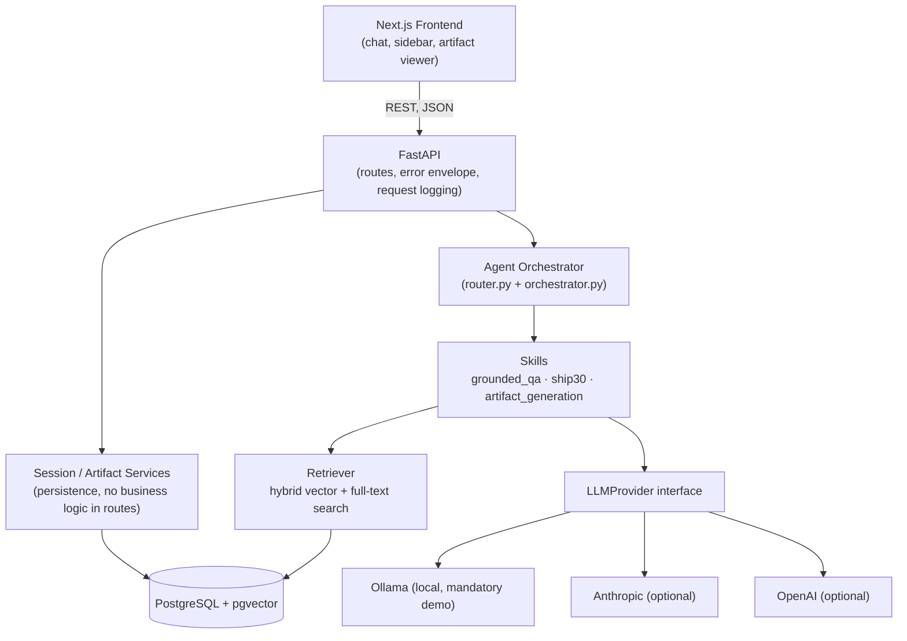
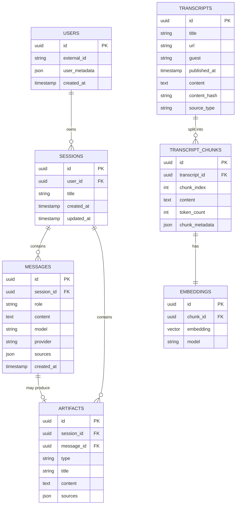
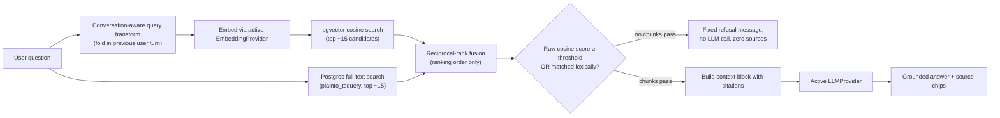
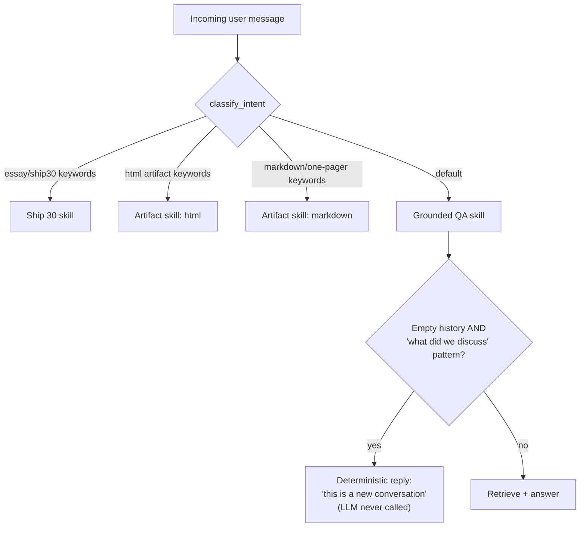
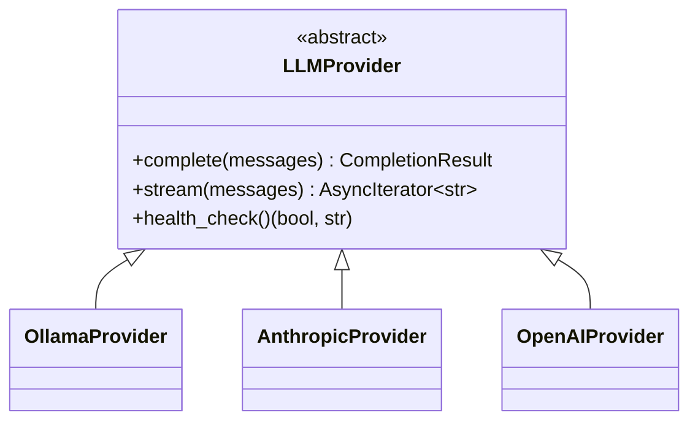
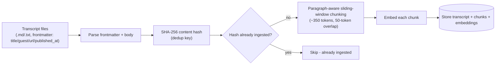
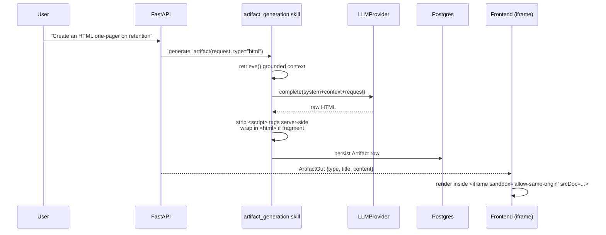
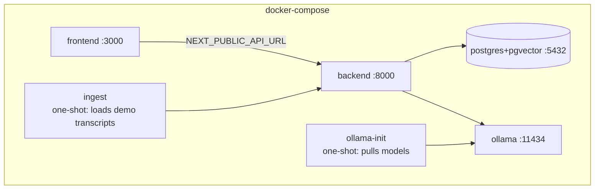

# Architecture — The Lenny Growth Assistant

## System overview

This matches the layering the take-home asked for: Frontend → FastAPI → Session Service → Agent
Orchestrator → Skills/Tools → Retriever → PostgreSQL/pgvector → LLM Provider. Retrieval is kept
strictly separate from generation (`app/retrieval/` never imports a provider; `app/providers/`
never imports the retriever), and skills are separate from the orchestrator (`app/agents/skills/`
contains no routing logic; `router.py` contains no prompt text).

## Why no LLM-driven tool calling

The take-home suggests the Anthropic Agent SDK or a tool-calling agent loop. This build uses a
**deterministic, code-based router** (`app/agents/router.py`) instead, for one concrete reason:
the mandatory local demo model is a small (~1B-parameter) Ollama model, which cannot be trusted
to reliably emit structured tool calls - in practice, small local models frequently either skip
tool calls, hallucinate arguments, or narrate the tool call in plain text instead of invoking it.
Making intent classification a deterministic, testable function (keyword/regex-based, unit
tested in `tests/test_router.py`) means routing behaves *identically* whether the active provider
is Ollama, Anthropic, or OpenAI - switching providers is purely a quality/latency change, not a
behavioral one. This is documented as a deliberate architecture decision, not an oversight.

## Database schema

`embeddings.embedding` is a pgvector `VECTOR(768)` column (matching `nomic-embed-text`'s output
size) with an HNSW cosine-distance index. Migrations live in `backend/alembic/`; the first
migration also runs `CREATE EXTENSION IF NOT EXISTS vector`, so a fresh Postgres needs no manual
setup beyond having the `pgvector` extension available (the `pgvector/pgvector:pg16` Docker image
ships it; the native-run README section covers installing it via Homebrew).

## RAG pipeline

**Why RRF alone isn't the groundedness signal:** reciprocal-rank fusion normalizes to the
candidate set's own rank order, so it always produces a "top" result near 1.0 even when *every*
candidate is irrelevant - it would silently defeat the refusal requirement. Groundedness is
instead judged on the **raw pgvector cosine similarity** (calibrated per corpus/embedding model -
see the comment on `retrieval_min_score` in `app/core/config.py`), with a full-text match treated
as independently sufficient evidence regardless of vector score (catches exact terms/names a
small embedding model under-weights). This was caught and fixed during development - see
`agent-transcripts/`.

## Agent / skill routing

The `GUARD` step is a deliberate, tested exception to "let the LLM handle it": a small local
model reliably conflates retrieved transcript excerpts with actual prior chat turns when asked to
recap a conversation that never happened, producing an answer that reads exactly like a
session-isolation leak even though the underlying data is correctly scoped per `session_id`. See
`app/agents/skills/grounded_qa.py` and `agent-transcripts/` for the incident.

## Model provider abstraction

`app/providers/factory.py` resolves the active provider from `LLM_PROVIDER` (env default) or a
runtime override set via `POST /api/models/select` (`app/core/runtime_state.py`) - no application
code imports a concrete provider class; routes and skills depend only on `LLMProvider` /
`EmbeddingProvider`, injected via FastAPI `Depends`. A missing cloud API key raises
`ProviderConfigError` (→ HTTP 503, `PROVIDER_CONFIG_ERROR`) at construction time, not a crash; an
unreachable Ollama raises `ModelUnavailableError` (→ HTTP 503, `MODEL_UNAVAILABLE`) with a message
telling the operator exactly what to run.

## Ingestion pipeline

Every chunk carries provenance (`chunk_metadata`: episode title, guest, url) independent of the
parent transcript row, so retrieval results always resolve to a citable source. Re-running
`scripts/ingest_transcripts.py` is safe: unchanged files are skipped via content hash, not
re-embedded (see `IngestionService` and its tests).

## Artifact generation & sandboxing

Two independent layers of defense, per `SECURITY.md`: the backend strips `<script>` tags before
persisting the artifact, and the frontend renders HTML artifacts in an iframe with
`sandbox="allow-same-origin"` and **no** `allow-scripts`, so even HTML the server-side stripper
missed cannot execute. Markdown artifacts are rendered via `react-markdown` (no `dangerouslySetInnerHTML`
anywhere in the codebase).

## Logging & observability

Structured JSON logs (via `structlog`) carry `request_id` (generated per HTTP request, echoed
back as an `x-request-id` response header), `session_id`, `operation`, `provider`, `model`,
`latency_ms`, `retrieval_count`, and `status`. Named events (`app/core/logging.py::Events`) match
the take-home's list: `REQUEST_STARTED`, `REQUEST_COMPLETED`, `RETRIEVAL_COMPLETED`,
`MODEL_STARTED`/`MODEL_COMPLETED`/`MODEL_FAILED`, `DATABASE_FAILED`, `ARTIFACT_CREATED`,
`ARTIFACT_RENDER_FAILED`, plus ingestion events. API keys, passwords, and message content are
never logged - only metadata about the request.

## Deployment topology

`ollama-init` and `ingest` are one-shot services gated by `condition: service_healthy` /
`service_completed_successfully`, so `docker compose up` brings the whole stack to a usable state
without a manual post-start step (ingestion is also safely re-runnable manually at any time).

## Security boundaries

See `SECURITY.md` for the full review. Summary: CORS restricted to the configured frontend
origin; no secrets ever logged; SQL executed exclusively via SQLAlchemy parameter binding (the
one raw-SQL vector/FTS query in `retriever.py` uses bound parameters, never string
interpolation); generated HTML is sandboxed at render time in addition to being sanitized at
generation time; no filesystem or arbitrary-URL access is exposed to the LLM or to generated
artifacts.

## Failure handling

| Failure | Behavior |
|---|---|
| Postgres unreachable | `/health/ready` reports `degraded`; a request needing the DB gets a structured 503 rather than an unhandled exception |
| Ollama unreachable | `ModelUnavailableError` → 503 `MODEL_UNAVAILABLE` with a specific remediation message |
| Configured Ollama model not pulled | Same as above, message names the exact `ollama pull <model>` to run |
| Cloud API key missing | `ProviderConfigError` → 503 `PROVIDER_CONFIG_ERROR` at provider construction, before any network call |
| Retrieval returns zero results | Deterministic refusal message, zero sources, no LLM call for grounded QA / Ship30; artifact generation still proceeds but is instructed to rely only on conversation context, not invented facts |
| Invalid request body | Pydantic validation → 422 `INVALID_REQUEST` with per-field details |
| Unknown session/artifact id | 404 `NOT_FOUND` |
| Malformed/unsupported artifact type | 400-class `ARTIFACT_GENERATION_FAILED` before any LLM call |
